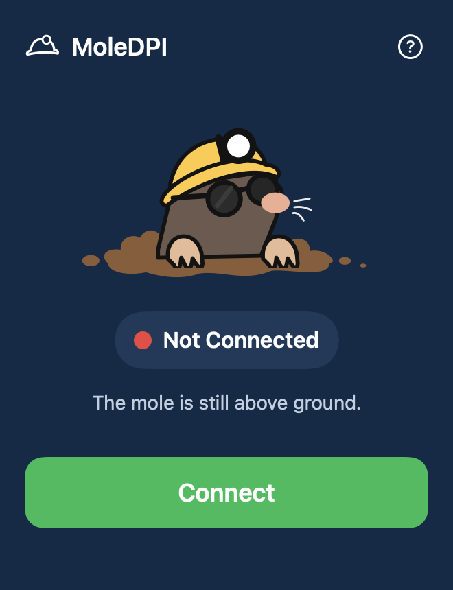

# MoleDPI — macOS DPI bypass

**Free, open-source local censorship circumvention for Apple Silicon.**

[Download for Mac](https://github.com/soykanozd/MoleDPI/releases/latest/download/MoleDPI.dmg) · [Latest release](https://github.com/soykanozd/MoleDPI/releases/latest) · [Türkçe kurulum](README-TR.md) · [Build from source](BUILDING.md)

**EXPERIMENTAL — bugs, connection failures and network interruptions may occur.**

A free, open-source macOS menu-bar application for trying local DPI circumvention with source-built zapret **tpws**. No remote VPN server or account is required.

  

*Interface preview rendered from the application. No live connection is shown.*

## At a glance

- Native SwiftUI menu-bar interface with Connect, Disconnect and safe Quit.
- Source-built zapret tpws engine; local TCP/TLS splitting with macOS Packet Filter.
- No VPN server, account, subscription or developer-operated relay.
- HTTPS verification, controlled reconnection and connection-help guidance.
- General-purpose TCP 80/443 processing. Experimental QUIC Initial fake-packet processing covers public UDP/443. Other UDP remains direct; anonymity is not provided.

**QUIC beta:** [v1.1.0-beta download](https://github.com/soykanozd/MoleDPI/releases/download/v1.1.0-beta/MoleDPI.dmg) · [Beta notes](https://github.com/soykanozd/MoleDPI/releases/tag/v1.1.0-beta). Experimental public UDP/443 support; other UDP stays direct.

## Download and install

**Apple Silicon · macOS 13 or later**

1. Download **[MoleDPI.dmg](https://github.com/soykanozd/MoleDPI/releases/latest/download/MoleDPI.dmg)** from Releases. For other releases, use **[all releases](https://github.com/soykanozd/MoleDPI/releases)**.
2. Open the disk image and drag **MoleDPI** onto **Applications**.
3. Open MoleDPI from Applications.
4. Click the helmet in the menu bar, then **Connect**.
5. Approve the local network helper if macOS asks.

No Terminal, Homebrew, Xcode or additional network tools are needed to run the packaged app.

**Important:** This experimental build is ad-hoc signed and **not notarized by Apple**. Gatekeeper may block an internet-downloaded copy. See [Apple's instructions for opening an app from an unidentified developer](https://support.apple.com/guide/mac-help/open-a-mac-app-from-an-unknown-developer-mh40616/mac). Only approve a copy you trust. Do not disable Gatekeeper. If macOS offers no permitted way to open this build, wait for a notarized release.

## Use

- Left-click the menu-bar helmet to show or hide the panel.
- Clicking elsewhere or pressing Escape hides the panel while the connection continues.
- **Disconnect** restores this session's network configuration and stops automatic recovery.
- Right-click the helmet and select **Quit MoleDPI** to clean up and exit.
- **?** opens About MoleDPI.

First installation and a changed application build may require administrator approval. Repeated Connect/Disconnect with the same approved build uses the installed helper.

## How it works

MoleDPI tests local TCP/TLS splitting strategies, then uses a restricted helper and macOS PF to process the current user's public TCP traffic on ports 80 and 443. Connected requires HTTPS checks, an active PF session and a positive packet count. This verifies specific control destinations rather than every website.

The controller tolerates isolated health-check failures and attempts controlled recovery after a worker failure. Reconnection uses bounded backoff, pauses new worker attempts while offline, and stops when you choose Disconnect or Quit. Reopening the app never automatically connects.

If the ordinary DNS path fails for supported recovery domains, MoleDPI can use Quad9 DNS-over-HTTPS through a session-only loopback bridge and a temporary, domain-scoped macOS resolver. This affects those domains across the Mac during the session.

## Known limitations

- **Experimental software. Bugs and outages are possible.**
- Apple Silicon binaries only. Minimum target macOS 13; runtime verification has been limited to a recent macOS release. Older macOS versions, Intel Macs and a clean-Mac install are not certified.
- DPI processing covers TCP 80/443. **Experimental QUIC processing also covers public UDP/443 for the signed-in user, over IPv4 and IPv6. Other UDP stays on the normal network.** Voice calls, screen sharing and games can work when their network paths are reachable. This is not a guarantee against every UDP block. See [UDP behavior and test scope](docs/UDP.md).
- Your public IP remains visible. This is not an anonymity service.
- Supplemental recovery queries use a local UDP/TCP bridge and certificate-verified DNS-over-HTTPS to Quad9. Quad9 can see those queries. Ordinary system DNS queries outside recovery remain governed by your system settings. HTTPS certificate validation stays enabled.
- Checks contact fixed public HTTPS control destinations listed in the source (`Model.swift`). These are test endpoints, not application-specific support promises. No browsing history, traffic-content logging or analytics SDK is included.
- VPNs, firewalls, sleep/wake and network changes may affect reliability. Long-duration stability has not been certified.
- Network processing uses root-owned software. Independent security review is still needed.
- Application-controlled error messages are in English; macOS-generated dialogs follow the system language.

## Remove

Disconnect and quit MoleDPI. Open **Uninstall MoleDPI** from the disk image, approve the macOS prompt, then move MoleDPI from Applications to the Trash. Deleting the main app alone leaves the helper registration installed. The experimental graphical uninstaller has been built and signature-checked; a clean-machine removal test remains pending.

## Source and acknowledgements

The engine is [zapret tpws](https://github.com/bol-van/zapret), pinned at `73ee2aa04e6e94922e7dc07554a1c3a456dc3201`. [GoodbyeDPI](https://github.com/ValdikSS/GoodbyeDPI) inspired the straightforward project documentation; its Windows driver is not bundled. [ByeDPI](https://github.com/hufrea/byedpi) was reviewed but is not bundled.

MoleDPI is **GPL-3.0-only**. See [LICENSE](LICENSE), [NOTICE](NOTICE) and [THIRD-PARTY.md](THIRD-PARTY.md). Complete corresponding source and build scripts are distributed alongside the binary and within its application bundle. Upstream copyright notices are retained.

See [BUILDING.md](BUILDING.md) for developer instructions.

## Network changes and updates
When the network changes or the Mac wakes, MoleDPI coalesces an immediate health check and preserves a working engine. A successful strategy number is saved locally and tried first next time; all candidates still undergo real verification. No network name or address is saved with this preference.

In **? → Check for Updates**, you can manually request GitHub release metadata. Checking is optional and contacts GitHub, which can see your request IP. No account, token or diagnostics is sent. **View Release** opens the project release page. Downloads and installation remain under your control.

## Diagnostics
Open **? → Review Diagnostics**, inspect the text, then choose **Copy Report** if you want to share it in an issue. Reports contain only allowlisted connection state and counters. Raw errors, account identifiers, IP addresses, paths and browsing history are excluded. Nothing is uploaded automatically.

The app uses public DNS infrastructure and your existing internet connection. It has no paid account, developer-operated relay, subscription or metered application API.

## Report a bug

Use [Issues](https://github.com/soykanozd/MoleDPI/issues). Include the app version, macOS version, action and error. Do not include passwords, tokens, browsing history, personal network details or unredacted screenshots.

### Connection help and network recovery
**? → Connection Help** explains the last observed failure category and safe next steps. DNS lookup, TLS, timeout, remote HTTP response and local engine failures are distinguished when there is evidence. An access failure alone cannot prove censorship. Diagnostics include the category only, never raw command output or destinations.

Wake and path events invalidate results from earlier network checks. The controller retains its consecutive-failure count across refreshes, preserves a working engine and pauses checks/new attempts during system sleep. Manual Disconnect and Quit still prevent reconnection. Physical sleep/wake and Wi-Fi roaming require testing on your own network; deterministic tests do not certify every network.

## Frequently asked questions

**Is MoleDPI a VPN?** No. It tries local TCP/TLS techniques; it does not route your traffic through a remote VPN server or hide your public IP.

**Will every website and app work?** No. Results depend on the network and filtering method. Connected means the engine and selected HTTPS checks passed, not universal access. Public UDP/443 is processed by the experimental QUIC backend; other UDP uses the normal network. Results depend on the filtering method.

**Why does macOS show an unidentified-developer warning?** Public builds currently use an ad-hoc signature and have no Apple notarization. Read the installation warning above and only approve software you trust.

**How do I update?** Open **? → Check for Updates**. When a newer version is found, **View Release** opens its GitHub release page. Disconnect and Quit before replacing the application in Applications.

## Help improve MoleDPI

Reproducible bug reports, sanitized compatibility results, documentation improvements and code review are welcome. See [Contributing](CONTRIBUTING.md) and [open an issue](https://github.com/soykanozd/MoleDPI/issues/new/choose). Keep personal details and browsing history out of public reports.

If MoleDPI is useful to you, a GitHub star or sharing the repository link can help others discover it. Please keep the experimental status and support limitations alongside any recommendation.

## Experimental UDP/443 integration (v1.1.0-beta)
Connect now starts source-built ByeDPI and a local HEV utun alongside the existing TCP engine. Only this user's public UDP/443 is routed through it. Fake packets are restricted to plausible QUIC v1/v2 Initial packets; unknown UDP/443 payloads are relayed without fake injection. The proxy drops to the nobody account. Private/LAN destinations, other users and other UDP ports are excluded. No remote VPN server, paid API or login is used. Default routes and DNS preferences are preserved.

The backend is joined on Disconnect/Quit; independent journal-based recovery handles worker loss. The fixed fake TTL is 8, not an ISP-calibrated strategy. A successful QUIC handshake proves transport operation, not that a real block was bypassed. HTTP/3 application semantics and universal game/voice access are not certified.

For an advanced TCP-only fallback, Quit first, then launch `open -a MoleDPI --args --tcp-only`. The ordinary panel is unchanged. Installing a changed ad-hoc build may require one helper approval. This beta is not Apple-notarized.
